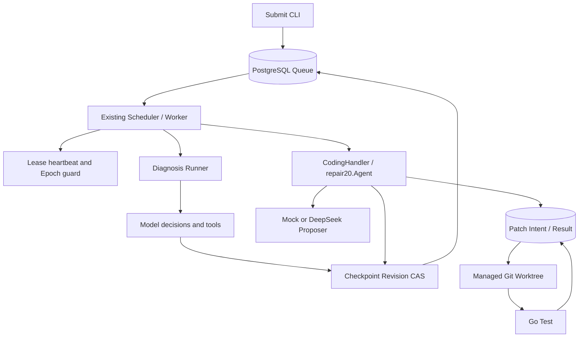
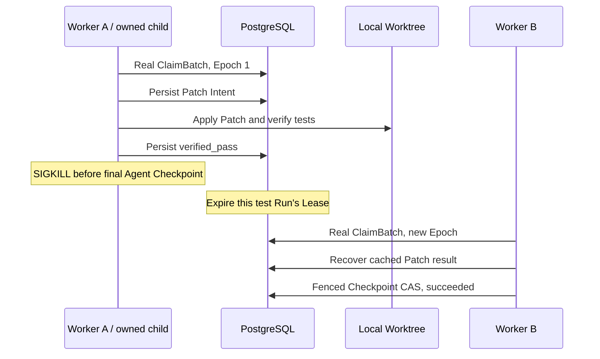

# Durable Coding Agent Runtime

[English](README.md) | [简体中文](README.zh-CN.md)

[Documentation showcase](https://github.com/Loz888/durable-coding-agent-runtime-showcase)

## Project overview

A Go agent runtime with PostgreSQL-backed scheduling, fenced checkpoints and
recoverable, single-file code repair in managed Git Worktrees.

## Motivation

**What should the next Worker do when the previous Worker changed a file but
died before recording completion?** This project records Patch Intent before
writing, reconciles the current SHA-256 after takeover, and commits results
only under a valid Lease/Epoch. A successful model response alone is not a
durable execution protocol.

## Key features

- Concurrent tool runtime: registry, Workers, context cancellation, timeout,
  retry/backoff, error classification and in-process metrics.
- PostgreSQL Agent Runs and revisioned JSON checkpoints.
- Atomic priority/availability queue claims using FOR UPDATE SKIP LOCKED.
- Lease heartbeat, Epoch Fencing and checkpoint Revision CAS.
- Diagnosis and Coding routes in the same existing Scheduler.
- Structured DeepSeek proposals and a deterministic Mock proposer.
- Managed Git Worktrees with source-commit and identity validation.
- Durable Patch Intent/Result, cached verification and crash reconciliation.
- Separate Claim, explicit-retry and logical-repair budgets.
- Real PostgreSQL, concurrent-owner and child-process SIGKILL tests.
- Day 21 deterministic Capture, strict scoring and auditable JSONL observations.

Day-numbered packages retain the tested implementation history without twenty
duplicate projects. The Go Module remains `runtime-app`. No unmeasured
throughput or latency numbers are claimed.

## Architecture



[Source manifest](docs/source-manifest.json) ·
[Architecture](docs/architecture.md) ·
[Execution lifecycle](docs/execution-lifecycle.md) ·
[Crash recovery](docs/crash-recovery.md) ·
[Patch protocol](docs/patch-protocol.md) ·
[Evaluation](docs/evaluation.md) ·
[Testing](docs/testing.md) ·
[Design decisions](docs/design-decisions.md)

## Quick start: Mock first

Use Linux/WSL2 with Bash, Git, Python 3, PostgreSQL 16 and the exact Go version
in [go.mod](go.mod), currently 1.27.1. Install Go from the
[official distribution](https://go.dev/doc/install), and install/start
[PostgreSQL](https://www.postgresql.org/download/) for your OS. Commands below
assume a running local PostgreSQL service, Unix-socket peer authentication and
sudo access to its administration account. If new test databases are needed,
run sudo -v in your own terminal first; existing accessible test databases
need no administration step.

Clone the public source repository:

```bash
git clone https://github.com/Loz888/durable-coding-agent-runtime-source.git
cd durable-coding-agent-runtime-source

go version
git --version
psql --version

# Idempotently creates only the two named test databases and a local login role.
./scripts/create_test_databases.sh

export DAY12_TEST_DATABASE_URL="host=/var/run/postgresql dbname=agent_runtime_day14_test user=$(id -un) sslmode=disable"
export TEST_DATABASE_URL="host=/var/run/postgresql dbname=agent_runtime_test user=$(id -un) sslmode=disable"

./scripts/setup_test_db.sh
./scripts/demo_mock.sh
./scripts/demo_crash_recovery.sh
```

The Mock Demo creates a temporary Git repository with a broken Divide function,
claims a real Run, enters the existing Scheduler execution path, applies a Mock
proposal in an isolated Worktree, runs Go tests and checks the final fenced
Checkpoint. It verifies that the original source is unchanged and a terminal
Run cannot be claimed again.

Expected final lines include:

```text
PASS=1 FAIL=0 SKIP=0
PASS: demo_mock
...
PASS: demo_crash_recovery
```

These are executable integration demos using the existing Go test harness,
not a separate agent implementation. The harness owns and cleans temporary
repositories, Worktrees, rows and Patch schemas. Both scripts check database
names, unset DEEPSEEK_API_KEY, retain JSON evidence outside the repository,
and fail on any test failure, SKIP or missing required scenario.

[evaldata/fixtures](evaldata/fixtures) also contains five curated nested Go
modules: four intentionally broken diagnosis inputs and one passing control.
Nested modules are excluded from root-module go test traversal.

For TCP PostgreSQL use equivalent DSNs with the same exact database names;
see [testing](docs/testing.md). [.env.example](.env.example) lists configuration
names only. Real credentials must stay outside version control.

## Crash recovery



The crash script additionally executes the four-state SIGKILL matrix:
prepared, applied, verified_pass and verified_fail. Assertions cover stale
owners, identity, repair budget, source isolation and cached-verdict reuse.
Only dedicated child processes are killed. Tests advance only their own Run's
expiry to keep the demo short; new Epochs still come from real ClaimBatch.

The harness drives the existing Scheduler.execute and public repair/Checkpoint
entry points. It is not a long-running daemon load test. These demonstrations
do not prove power-loss safety, arbitrary external-side-effect exactly-once,
distributed filesystem correctness or multi-host workspace reconstruction.

## Evaluation results

The recorded Day 21 Mock experiment covers four scenarios with three trials each:

| Metric | Recorded result |
| --- | ---: |
| Scenario correctness | 12/12 |
| Fresh repair | 3/3 |
| Verified-result recovery | 3/3 |
| Unsupported success claims | 0/9 claimed successes |
| P50 / P95 | 400 / 1403 ms |

This is controlled deterministic evaluation, not a real DeepSeek repair success
rate or an open-world benchmark. Token usage is unknown, not measured as zero.
Latency covers claim-to-checkpoint execution, excluding independent proof;
recovery also excludes preparing Worker A's verified result.
The nearest-rank P95 of 12 samples is the largest recorded duration.

The [case manifest](evaldata/day21/cases.json), [observations](evaldata/day21/runs.jsonl),
[summary](evaldata/day21/summary.json) and [generated report](evaldata/day21/report.md)
are committed for review. [Evaluation methodology](docs/evaluation.md) explains
denominators, proof rules, environment limits and offline report reproduction.

After Quick Start database setup, run a fresh capture:

```bash
./scripts/day21_accept.sh
```

It uses the existing Scheduler and Patch Store and checks all 12 trials.
Fresh output goes to a new external temporary directory. The committed dataset
remains unchanged, and fresh timing is reported separately.

## Design decisions

The queue and checkpoints share PostgreSQL transactional authority.
Epoch Fencing rejects stale owners, while Revision CAS orders checkpoint updates.
Patch Intent and Before/After SHA reconcile the filesystem/SQL gap.
Separate claim, retry and repair budgets prevent takeover from resetting limits.
These choices have costs; see [design decisions](docs/design-decisions.md).

## Testing and CI

After database setup:

```bash
env -u DEEPSEEK_API_KEY go test -count=1 -timeout 360s ./...
env -u DEEPSEEK_API_KEY go test -race -count=1 -timeout 360s ./...
env -u DEEPSEEK_API_KEY go vet ./...

# Strict JSON runners additionally reject every SKIP.
./scripts/test.sh ./...
./scripts/test.sh -race ./...
./scripts/test_unit.sh
```

[CI](.github/workflows/ci.yml) reads the Go version from go.mod and provides
format/vet/build, database-independent tests, full PostgreSQL integration
tests and a full race suite. PostgreSQL jobs create both fixed database names,
apply migrations 001–006, and reject SKIP. No model key is injected.
Check the actual [Actions runs](https://github.com/Loz888/durable-coding-agent-runtime-source/actions)
for remote status; no static green status is asserted here. CI also checks the
Day 21 Capture and reproduces the recorded evaluation report.

## Repository map

| Directory | Responsibility |
|---|---|
| cmd | Retained commands: Worker, submit, Patch and earlier demos |
| runtimecore, executor, task, observability | Concurrent tool runtime |
| distributed | Earlier HTTP coordinator/Worker experiment |
| durable | Queue, Lease, Scheduler, fenced checkpoints, CodingHandler |
| reliability15 | Retry/failure policy, exhaustion Sweep and events |
| repodiag | Diagnosis tools and model adapters |
| repair17 / repair18 | Worktree/Patch primitives and proposer loop |
| repair19 / repair20 | Durable Patch Store and recovery-first repair agent |
| persistence, httpapi | Persistent task API and result collection |
| internal/integration20 | Independent cross-module recovery tests |
| eval16, eval21, evaldata | Diagnosis fixtures, deterministic Capture observations and strict scoring |
| migrations, scripts, docs | Schema, reproducible entry points and design |

Legacy scripts are retained. The old Day19 lab uses synthetic owner changes;
use the new crash demo for real Queue claims. Older experiments may require
explicit trusted-repository/database settings and are not Quick Start steps.

Worker supports -worktree-base or WORKTREE_BASE, defaulting to ./worktrees.
Its controlled Coding configuration targets math.go, with two rounds and a
30-second Go-test timeout. Diagnosis options and model factory are preserved.

## Limitations

- Trusted Go repositories only: their tests execute with Worker OS privileges.
  There is no untrusted-code Docker/VM sandbox.
- Coding repair targets one configured file, not arbitrary multi-file changes.
- File Rename and SQL Commit are separate; Intent/SHA reconciliation covers
  the tested gap, not a distributed atomic transaction.
- No arbitrary-external-effect exactly-once guarantee. Diagnosis tools can
  replay when their output checkpoint was not committed.
- Recovery assumes the same valid local Worktree; multi-host transport and
  reconstruction are not implemented.
- Lease times use the database wall clock; choose adequate TTL and keep host
  time synchronized.
- Legacy identity-less Worktree bindings need explicit audit/migration.
- A legacy model factory without Context cannot safely be force-stopped if it
  never returns; use the optional context-aware factory for slow initialization.

## Roadmap

Multi-file Patch, sandbox isolation, broader repair evaluation, OpenTelemetry,
measured Worker-throughput benchmarks and multi-host Worktree recovery remain
future work.

简要说明：这是一个关注执行授权、持久化和崩溃恢复的 Go Agent 工程。
Mock 与故障 Demo 无需真实模型密钥。源码仓库已公开，尚未选择软件 License。
