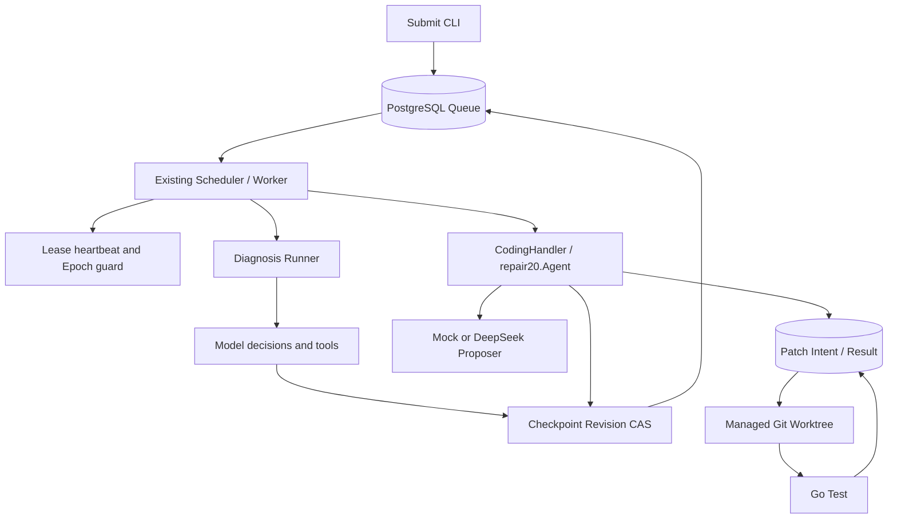
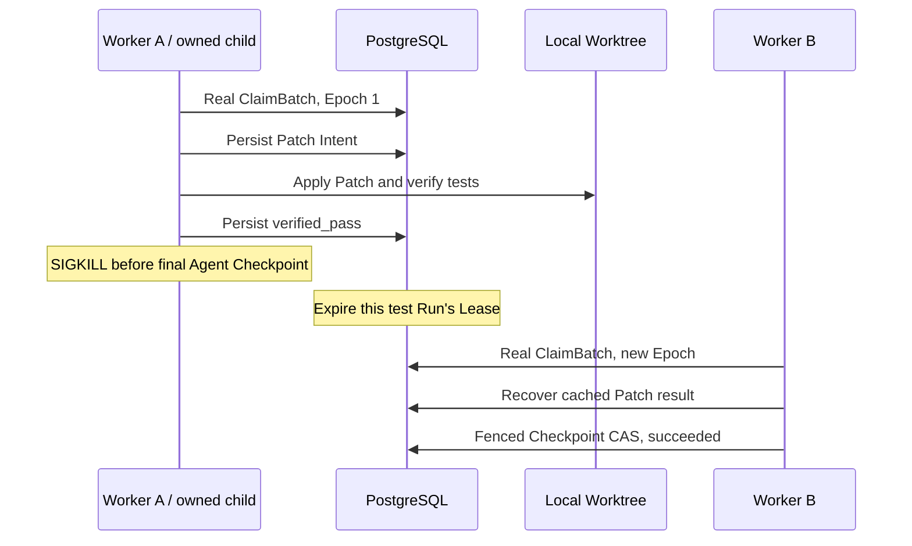

# Durable Coding Agent Runtime

[English](README.md) | [简体中文](README.zh-CN.md)

<!-- publication-note-20261022 -->
> This publication includes the validated upgrades below. “Local/uncommitted/not pushed” statements are retained acceptance-time snapshots; use repository commits and Actions for publication and CI status. Two synthetic test DSNs were changed to explicit placeholders before publication, preserving decoding and error-redaction assertions; related offline checks were rerun.


<!-- runtime-followup:start -->
## 2026-10-22 follow-up: sealed sandbox inputs and measured evidence

The shared metadata-only input planner now generates fixed offline commands for standalone, sealed-vendor and bounded workspace snapshots. Worker verification policy v4 includes the input mode. Four real Docker scenarios passed (vendor/workspace success and actual assertion failure), preserving non-root, read-only, offline execution and no host fallback.

A read-only artifact inventory passed five controlled categories without changing files or references. Two reference observations never authorize deletion; coordinated artifact GC remains unimplemented. Twelve additional synthetic trials completed **12,003 tasks, zero failures and zero extra claims**, including 35-second callbacks against an initial 30-second lease, pool limits 4/20 and approximately 107-second paced trials. Six negative database wall durations remain recorded; these are not production capacity, long-term soak or model throughput results.

One frozen real upstream go-humanize regression failed on its parent and passed with the known upstream fix inside offline containers. **Model calls: 0.** Runtime ingestion, representative real-defect evaluation and independent human review remain unverified. A read-only probe accounting for scheduling uncertainty still observed three OS and three PostgreSQL backsteps over 90 seconds; the time service remains unchanged pending the separate A/B authorization.

[Follow-up evidence](reports/runtime-followup-20261022/README.md)
Full regression and race: **407 PASS / 0 FAIL / 0 SKIP each**. The database-independent entry passed 206 Go events and 7 Python tests; event counts include parents/subtests. Local changes only: no commit, push, or new paid call.
<!-- runtime-followup:end -->


> Local monitoring reproduced OS and PostgreSQL wall-clock backsteps. A system-wide WSL time-sync A/B is awaiting explicit approval; it has not been applied. Primary benchmark timing is monotonic.

> Previous batch full/race: 338 PASS each; ten recovery repeats: 220 PASS; unit entrypoint: 153 PASS. Zero FAIL/SKIP. Real Docker/fenced container recovery passed. See source reports/runtime-remaining-20261022. Events include parent/subtests; no commit/push.


## Local upgrade · 2026-10-22 (unpublished)

This section describes the current working tree; older dated “pending/BLOCKED” statements are historical. No commit, push or remote-CI result is implied.

Implemented bounded multi-file patches (up to 8 allowlisted existing Go files per repair round), persisted logical model responses with conservative unknown-outcome handling, real Docker confinement and an independent scoped orphan reaper, OTLP/metrics/local alert acceptance, paced/real-Go-test benchmark workloads, and content-addressed portable Worktree recovery. Two isolated host containers plus a separate authenticated artifact service passed actual A-container SIGKILL, natural lease expiration and a real Epoch2 ClaimBatch takeover. This remains one physical computer, with no physical-host/power-loss claim.

The frozen 12-task synthetic live evaluation made **11 actual requests**, **3382 input / 4201 output tokens**: 9 fresh repairs and one response-recovery control passed holdout assertions; an immutable failure control failed as expected; an already-passing baseline made zero requests. Mode: High, requested/returned alias `deepseek-flash`. The peak cache-miss estimate is **$0.0060558**, not an invoice, against this run's separately authorized $2 cap. These simple manually constructed tasks do not measure general repository repair accuracy.

Explicit sealed input policies capture offline vendor inputs or root-contained workspace modules, with shared fixed-command planning for trusted-local and sandbox execution. Terminal Worktrees can be inspected/dry-run and retired with identity/state checks and a persisted deletion intent. A separate fresh local PostgreSQL cluster restored synthetic data and read-only role permissions.

Portable recovery requires a previously published artifact and durable patch history. Disk loss before the first publication and unobserved model responses are not automatically recovered.

Remaining unverified: a second physical host, network partition/power loss, arbitrary hostile repositories, representative real-world defects and human review, production soak/capacity, and the cause of two historical negative DB wall-clock durations. Monotonic benchmark timing does not remove the Lease clock assumption.


> **Local extension batch, 2026-10-21:** real-PG synthetic throughput, opt-in OpenTelemetry tracing and a 20-case scripted/independent-oracle evaluation are implemented locally. Apply migrations 001–012 before enabling tracing. Actual container isolation remains blocked; multi-file and cross-host recovery are not implemented. See [implementation and scope](docs/review-20261020/IMPLEMENTATION.md#2026-10-21-扩展批次1观测持久队列基准与离线评测) and the latest dated [results](docs/review-20261020/RESULTS.md). These local changes are not published.


[Documentation showcase](https://github.com/Loz888/durable-coding-agent-runtime-showcase)

## Project overview

A Go agent runtime with PostgreSQL-backed scheduling, fenced checkpoints and
recoverable, bounded multi-file code repair in managed Git Worktrees.

[本地可复现演示](docs/demo-script.md) · [能力与证据索引](docs/review-20261020/IMPLEMENTATION.md) · [本轮复验记录](reports/review-20261020/local-walkthrough.json)

## 本地工程收口 · 2026-10-21 / Local completion and verification

候选全树快照、验证输入摘要与受限证据收尾已接入现有 Store/Scheduler。最后一次 Claim 后的 verified_pass 可在完整输入仍匹配时直接收尾，不增加 Claim/Epoch、修复轮数或模型请求；旧 Owner 仍被拒绝。当前验证范围是标准库依赖的独立 Go 模块，外部依赖/replace、workspace、vendor、链接等明确拒绝；不因此扩大代码修复范围。

先应用增量迁移 **010/011**，停用旧 Worker 后升级；历史缺摘要记录必须在有效执行授权下重验，不能追认旧 PASS。下方 10 月 20 日数字是历史快照，本轮结果见[验收说明](docs/review-20261020/RESULTS.md)和[演示](docs/demo-script.md)。本次修改仅在本地，未推送；模型继续 High，没有新增 Live 调用。

## System review fixes · 2026-10-20

[Review implementation and remaining scope](docs/review-20261020/IMPLEMENTATION.md) · [Machine verification](reports/review-20261020/verification.json)

Terminal checkpoint completion times now freeze atomically. Diagnostic execution status is separate from structured observation/evidence verdicts; the gate does not prove semantic root causes. Both model adapters share sanitized failure/retry/uncertain-charge semantics. The obsolete Day15 fault script is explicitly retired with its original text preserved. Full and race checks each pass 260 test/subtest events in dedicated databases; historical live-model records remain unchanged.

[Results, changes and evidence boundaries](docs/review-20261020/RESULTS.md) · [CI evidence at 645c88e](reports/review-20261020/remote-ci.json)

| Evidence | Recorded outcome |
|---|---|
| Review regression / race | 260 / 260 passing test/subtest events; zero failures or skips |
| Historical Day21 Mock | 12/12 controlled scenarios; not live-model accuracy |
| Historical live repair | One patch, tests passed; exact model snapshot/effort unknown |

## Earlier pilot snapshot · 2026-10-20

[Earlier pilot implementation and verification](docs/pilot/STATUS.md) · [已完成成果与后续缺口](docs/pilot/IMPROVEMENT_OUTLINE.zh-CN.md)

The update retains the existing durable execution protocol and adds scoped API identities, cancellation, execution-profile separation and shared model admission/accounting. A [historical live DeepSeek repair](evaldata/historical/day18-deepseek/README.md) is now preserved separately from the Day21 Mock results. It succeeded after one patch with recorded usage of 274 input / 94 output tokens; exact model snapshot/effort was not captured. Container sandbox execution remains unverified without an engine. See the review results above for current verification; the pilot page retains its earlier snapshot.

## Motivation

**What should the next Worker do when the previous Worker changed a file but
died before recording completion?** This project records Patch Intent before
writing, reconciles the current SHA-256 after takeover, and commits results
only under a valid Lease/Epoch. A successful model response alone is not a
durable execution protocol.

## Key features

- Concurrent tool runtime: registry, Workers, context cancellation, timeout,
  retry/backoff, error classification and in-process metrics.
- PostgreSQL Agent Runs and revisioned JSON checkpoints.
- Atomic priority/availability queue claims using FOR UPDATE SKIP LOCKED.
- Lease heartbeat, Epoch Fencing and checkpoint Revision CAS.
- Diagnosis and Coding routes in the same existing Scheduler.
- Structured DeepSeek proposals and a deterministic Mock proposer.
- Managed Git Worktrees with source-commit and identity validation.
- Durable Patch Intent/Result, cached verification and crash reconciliation.
- Separate Claim, explicit-retry and logical-repair budgets.
- Real PostgreSQL, concurrent-owner and child-process SIGKILL tests.
- Day 21 deterministic Capture, strict scoring and auditable JSONL observations.

Day-numbered packages retain the tested implementation history without twenty
duplicate projects. The Go Module remains `runtime-app`. No unmeasured
throughput or latency numbers are claimed.

## Architecture



[Source manifest](docs/source-manifest.json) ·
[Architecture](docs/architecture.md) ·
[Execution lifecycle](docs/execution-lifecycle.md) ·
[Crash recovery](docs/crash-recovery.md) ·
[Patch protocol](docs/patch-protocol.md) ·
[Evaluation](docs/evaluation.md) ·
[Testing](docs/testing.md) ·
[Design decisions](docs/design-decisions.md)

## Quick start: Mock first

Use Linux/WSL2 with Bash, Git, Python 3, PostgreSQL 16 and the exact Go version
in [go.mod](go.mod), currently 1.27.1. Install Go from the
[official distribution](https://go.dev/doc/install), and install/start
[PostgreSQL](https://www.postgresql.org/download/) for your OS. Commands below
assume a running local PostgreSQL service, Unix-socket peer authentication and
sudo access to its administration account. If new test databases are needed,
run sudo -v in your own terminal first; existing accessible test databases
need no administration step.

Clone the public source repository:

```bash
git clone https://github.com/Loz888/durable-coding-agent-runtime-source.git
cd durable-coding-agent-runtime-source

go version
git --version
psql --version

# Idempotently creates only the two named test databases and a local login role.
./scripts/create_test_databases.sh

export DAY12_TEST_DATABASE_URL="host=/var/run/postgresql dbname=agent_runtime_day14_test user=$(id -un) sslmode=disable"
export TEST_DATABASE_URL="host=/var/run/postgresql dbname=agent_runtime_test user=$(id -un) sslmode=disable"

./scripts/setup_test_db.sh
./scripts/demo_mock.sh
./scripts/demo_crash_recovery.sh
```

The Mock Demo creates a temporary Git repository with a broken Divide function,
claims a real Run, enters the existing Scheduler execution path, applies a Mock
proposal in an isolated Worktree, runs Go tests and checks the final fenced
Checkpoint. It verifies that the original source is unchanged and a terminal
Run cannot be claimed again.

Expected final lines include:

```text
PASS=1 FAIL=0 SKIP=0
PASS: demo_mock
...
PASS: demo_crash_recovery
```

These are executable integration demos using the existing Go test harness,
not a separate agent implementation. The harness owns and cleans temporary
repositories, Worktrees, rows and Patch schemas. Both scripts check database
names, unset DEEPSEEK_API_KEY, retain JSON evidence outside the repository,
and fail on any test failure, SKIP or missing required scenario.

[evaldata/fixtures](evaldata/fixtures) also contains five curated nested Go
modules: four intentionally broken diagnosis inputs and one passing control.
Nested modules are excluded from root-module go test traversal.

For TCP PostgreSQL use equivalent DSNs with the same exact database names;
see [testing](docs/testing.md). [.env.example](.env.example) lists configuration
names only. Real credentials must stay outside version control.

## Crash recovery



The crash script additionally executes the four-state SIGKILL matrix:
prepared, applied, verified_pass and verified_fail. Assertions cover stale
owners, identity, repair budget, source isolation and cached-verdict reuse.
Only dedicated child processes are killed. Tests advance only their own Run's
expiry to keep the demo short; new Epochs still come from real ClaimBatch.

The harness drives the existing Scheduler.execute and public repair/Checkpoint
entry points. It is not a long-running daemon load test. These demonstrations
do not prove power-loss safety, arbitrary external-side-effect exactly-once,
distributed filesystem correctness or multi-host workspace reconstruction.

## Evaluation results

The recorded Day 21 Mock experiment covers four scenarios with three trials each:

| Metric | Recorded result |
| --- | ---: |
| Scenario correctness | 12/12 |
| Fresh repair | 3/3 |
| Verified-result recovery | 3/3 |
| Unsupported success claims | 0/9 claimed successes |
| P50 / P95 | 400 / 1403 ms |

This is controlled deterministic evaluation, not a real DeepSeek repair success
rate or an open-world benchmark. Token usage is unknown, not measured as zero.
Latency covers claim-to-checkpoint execution, excluding independent proof;
recovery also excludes preparing Worker A's verified result.
The nearest-rank P95 of 12 samples is the largest recorded duration.

The [case manifest](evaldata/day21/cases.json), [observations](evaldata/day21/runs.jsonl),
[summary](evaldata/day21/summary.json) and [generated report](evaldata/day21/report.md)
are committed for review. [Evaluation methodology](docs/evaluation.md) explains
denominators, proof rules, environment limits and offline report reproduction.

After Quick Start database setup, run a fresh capture:

```bash
./scripts/day21_accept.sh
```

It uses the existing Scheduler and Patch Store and checks all 12 trials.
Fresh output goes to a new external temporary directory. The committed dataset
remains unchanged, and fresh timing is reported separately.

## Design decisions

The queue and checkpoints share PostgreSQL transactional authority.
Epoch Fencing rejects stale owners, while Revision CAS orders checkpoint updates.
Patch Intent and Before/After SHA reconcile the filesystem/SQL gap.
Separate claim, retry and repair budgets prevent takeover from resetting limits.
These choices have costs; see [design decisions](docs/design-decisions.md).

## Testing and CI

After database setup:

```bash
env -u DEEPSEEK_API_KEY go test -count=1 -timeout 360s ./...
env -u DEEPSEEK_API_KEY go test -race -count=1 -timeout 360s ./...
env -u DEEPSEEK_API_KEY go vet ./...

# Strict JSON runners additionally reject every SKIP.
./scripts/test.sh ./...
./scripts/test.sh -race ./...
./scripts/test_unit.sh
```

[CI](.github/workflows/ci.yml) reads the Go version from go.mod and provides
format/vet/build, database-independent tests, full PostgreSQL integration
tests and a full race suite. PostgreSQL jobs create both fixed database names,
apply migrations 001–011, and reject SKIP. No model key is injected.
Check the actual [Actions runs](https://github.com/Loz888/durable-coding-agent-runtime-source/actions)
for remote status; no static green status is asserted here. CI also checks the
Day 21 Capture and reproduces the recorded evaluation report.

## Repository map

| Directory | Responsibility |
|---|---|
| cmd | Retained commands: Worker, submit, Patch and earlier demos |
| runtimecore, executor, task, observability | Concurrent tool runtime |
| distributed | Earlier HTTP coordinator/Worker experiment |
| durable | Queue, Lease, Scheduler, fenced checkpoints, CodingHandler |
| reliability15 | Retry/failure policy, exhaustion Sweep and events |
| repodiag | Diagnosis tools and model adapters |
| repair17 / repair18 | Worktree/Patch primitives and proposer loop |
| repair19 / repair20 | Durable Patch Store and recovery-first repair agent |
| persistence, httpapi | Persistent task API and result collection |
| internal/integration20 | Independent cross-module recovery tests |
| eval16, eval21, evaldata | Diagnosis fixtures, deterministic Capture observations and strict scoring |
| migrations, scripts, docs | Schema, reproducible entry points and design |

Legacy scripts are retained. The old Day19 lab uses synthetic owner changes;
use the new crash demo for real Queue claims. Older experiments may require
explicit trusted-repository/database settings and are not Quick Start steps.

Worker supports -worktree-base or WORKTREE_BASE, defaulting to ./worktrees.
Its controlled Coding configuration targets math.go, with two rounds and a
30-second Go-test timeout. Diagnosis options and model factory are preserved.

## Limitations

- Up to 8 allowlisted existing non-test Go files; no arbitrary large-repository repair or file creation/deletion.
- Real Docker boundaries were exercised; trusted-local/sealed-input policies remain trusted host execution.
- Portable recovery needs a matching clean clone, database and private artifacts; independent containers were tested, a second physical host/power loss was not.
- SQL, file Rename and artifact upload are separate durability boundaries. Unknown model outcomes/charges and external side effects have no Exactly-once claim.
- Synthetic live cases are not representative repository repair accuracy; Lease decisions still rely on the DB wall clock.


## Roadmap

See the current 2026-10-22 scope above. Next evidence requires a second physical host, representative open-source defects with human review, longer load tests and clock diagnostics.
