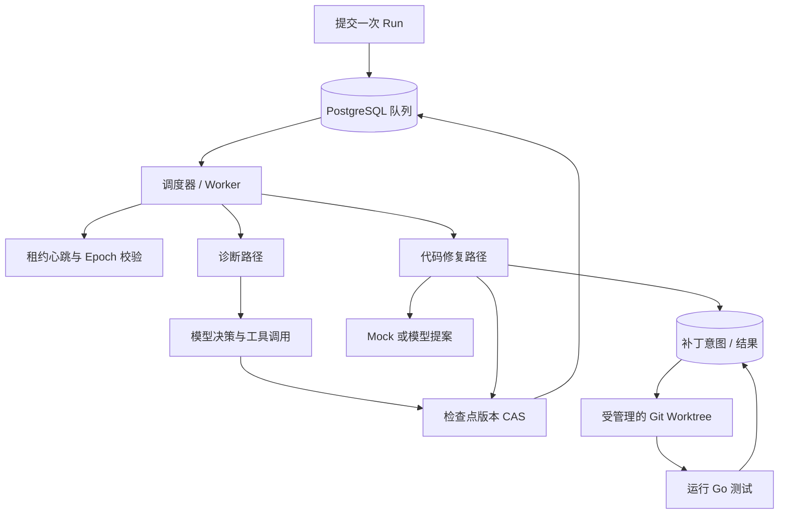
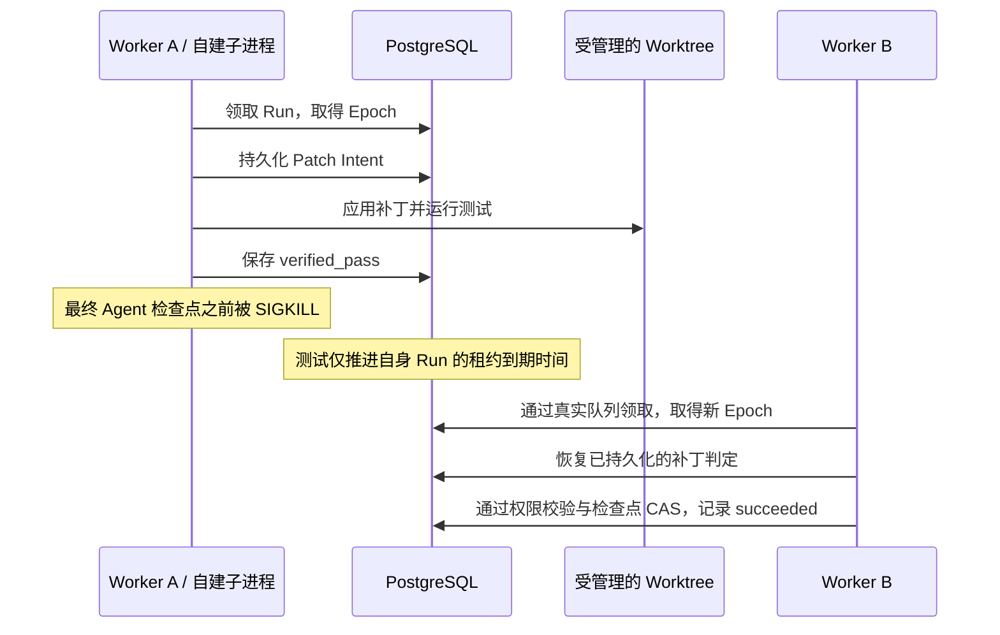

# Durable Coding Agent Runtime · 项目介绍

[English](README.md) | [简体中文](README.zh-CN.md)

一个使用 Go 构建的 Agent 工程项目，关注执行状态持久化、PostgreSQL 调度、
租约校验，以及受控代码修复中的崩溃恢复。

**本仓库公开实现源码、测试、数据库迁移和可执行 Demo。**
建议先阅读架构与能力边界，再运行不需要真实模型 API Key 的 Mock 演示。
数据库测试使用专用测试库；实际凭据保留在版本控制之外。

仅阅读设计说明，可访问[双语文档展示版](https://github.com/Loz888/durable-coding-agent-runtime-showcase)。

## 项目解决什么问题

Worker 修改文件后，可能在记录完成状态之前崩溃。
接手的 Worker 需要确认之前已经发生了什么，重新取得执行权限，
并在不依赖上一个进程内存的情况下完成后续工作。

实现采用以下方式处理这个窗口：写文件前持久化 Patch Intent（补丁意图），
恢复时核对文件哈希，持有有效 Lease（租约）和 Epoch（执行代次）时才允许保存结果。
补丁完成与 Agent Run 完成是两个独立的持久化边界。

## 已实现的能力

本仓库已实现以下能力：

- PostgreSQL 队列，支持按优先级和可用时间原子领取任务。
- 租约心跳、Worker Epoch 隔离校验，以及检查点 Revision CAS（版本比较并交换）。
- 在同一个现有 Scheduler 中调度诊断与代码修复两条路径。
- 使用 Git Worktree 隔离修改，并校验基线提交与工作区身份。
- 持久化 Patch Intent/Result，覆盖四种补丁状态的崩溃恢复。
- 分别限制领取次数、显式重试次数和逻辑修复轮次。
- 使用确定性的 Mock 提案，完成受控的单文件 Go 修复。
- 真实 PostgreSQL、并发持有者和自建子进程 SIGKILL 测试。

项目未声明未经测量的吞吐量或延迟指标。

## 系统架构



## 阅读导航

| 文档 | 主要内容 |
| --- | --- |
| [系统架构](docs/zh-CN/architecture.md) | 组件职责、持久化边界与 Worktree 归属 |
| [执行生命周期](docs/zh-CN/execution-lifecycle.md) | 领取、心跳、检查点与重试流程 |
| [崩溃恢复](docs/zh-CN/crash-recovery.md) | Worker 退出后的接管与状态核对 |
| [补丁协议](docs/zh-CN/patch-protocol.md) | 补丁意图、文件哈希、受保护写入与缓存判定 |
| [设计取舍](docs/zh-CN/design-decisions.md) | 技术选择、代价与适用边界 |
| [测试策略](docs/zh-CN/testing.md) | 私有实现的测试场景与验收规则 |
| [验证结果](docs/zh-CN/validation.md) | 已记录的结果及公开文档的验证范围 |

## 快速开始：先运行 Mock

使用 Linux/WSL2、Bash、Git、Python 3、PostgreSQL 16，
以及 [go.mod](go.mod) 指定的 Go 版本（当前为 1.27.1）。
以下命令假定本机 PostgreSQL 服务已运行，通过 Unix Socket 的 peer 认证连接。

如果需要新建专用测试库，请先在自己的终端执行 sudo -v。
两个测试库已存在且当前用户可以访问时，不需要管理权限。

```bash
git clone https://github.com/Loz888/durable-coding-agent-runtime-source.git
cd durable-coding-agent-runtime-source

go version
git --version
psql --version

./scripts/create_test_databases.sh

export DAY12_TEST_DATABASE_URL="host=/var/run/postgresql dbname=agent_runtime_day14_test user=$(id -un) sslmode=disable"
export TEST_DATABASE_URL="host=/var/run/postgresql dbname=agent_runtime_test user=$(id -un) sslmode=disable"

./scripts/setup_test_db.sh
./scripts/demo_mock.sh
./scripts/demo_crash_recovery.sh
```

预期末尾包含以下结果：

```text
PASS=1 FAIL=0 SKIP=0
PASS: demo_mock
...
PASS: demo_crash_recovery
```

脚本检查实际数据库名称、清除模型 Key 环境变量，
并在出现失败、跳过或缺失的必需场景时返回失败。
它们使用现有 Go 测试入口，不另外实现一套 Agent。

[.env.example](.env.example) 仅列出配置名称与占位值。
TCP 连接的配置要求见[测试说明](docs/zh-CN/testing.md)。
[evaldata/fixtures](evaldata/fixtures) 中的五个嵌套 Go 模块包含四个有意失败的诊断输入和一个通过对照，
由各自的 go.mod 隔离，不参加根模块的普通测试遍历。

## 修复演示流程

Mock 演示在本仓库测试入口中执行以下受控实验。

1. 创建临时 Git 仓库，放入单文件 Divide 函数的失败测试。
2. 提交一次 Run，通过真实队列领取操作取得任务。
3. 进入现有 Scheduler 执行路径，启动租约心跳并准备受管理的 Worktree。
4. 获取确定性的 Mock 提案，在应用补丁之前先持久化 Patch Intent。
5. 在 Worktree 中运行 Go 测试，保存验证结果。
6. 保存经过执行权限校验的 Agent 检查点，并验证原始仓库未被修改、
   已完成的 Run 不会再次被领取。

Mock 路径不需要真实模型 API Key。该实验记录的结果是修复场景通过；
脚本会报告结果，并将原始测试证据保留在版本控制之外。

## 崩溃恢复演示流程



崩溃测试还分别在 prepared、applied、verified_pass 和 verified_fail 状态后，
终止测试自己创建的子进程。接管时的 Epoch 来自真实队列领取。
为了缩短等待，测试只推进自身 Run 的到期时间，不直接修改 Epoch 来模拟接管。

这些是有明确范围的集成测试场景，不能代替长期生产负载测试。

## 验证结果概览

实现的已记录验证环境为 Linux/WSL、Go 1.27.1 和 PostgreSQL 16，
未使用真实模型 API Key：

| 已记录的测试集 | 通过的测试条目 | FAIL | SKIP |
| --- | ---: | ---: | ---: |
| 全项目测试 | 207 | 0 | 0 |
| 全项目竞态检测 | 207 | 0 | 0 |
| 不依赖数据库的测试集 | 127 | 0 | 0 |

条目数包含父测试、子测试和子进程辅助测试入口。
以上是先前验证记录，条目统计包含父测试、子测试和子进程辅助入口。
新仓库当前状态请以 [Actions](https://github.com/Loz888/durable-coding-agent-runtime-source/actions) 为准；
详见[验证结果说明](docs/zh-CN/validation.md)。

## 运行测试与 CI

完成专用测试数据库配置后执行：

```bash
env -u DEEPSEEK_API_KEY go test -count=1 -timeout 300s ./...
env -u DEEPSEEK_API_KEY go test -race -count=1 -timeout 300s ./...
env -u DEEPSEEK_API_KEY go vet ./...

./scripts/test.sh ./...
./scripts/test.sh -race ./...
./scripts/test_unit.sh
```

[CI 工作流](.github/workflows/ci.yml) 包含格式检查、静态分析、构建、
不依赖数据库的测试、真实 PostgreSQL 集成测试与全量竞态检测。
数据库任务只创建两个专用测试库、应用 001–006 迁移，并拒绝测试 SKIP。
不会注入真实模型 API Key。

## 能力范围与限制

- 当前支持受控的单文件 Go 修复；任意多文件仓库修复属于后续工作。
- 仅适用于可信仓库：测试继承 Worker 的操作系统权限，尚未实现不可信代码沙箱。
- 文件系统 Rename 与 SQL Commit 仍是两个独立操作。
- 恢复依赖同一个有效的本地 Worktree；跨主机重建属于后续工作。
- 不保证任意外部副作用都恰好发生一次。
- 租约判断依赖数据库墙上时钟，需要合理设置 TTL。
- Worktree 身份校验以可信写入者模型为前提。

## 后续计划

多文件补丁、沙箱隔离、更广泛的修复评估、OpenTelemetry、
实测吞吐量基准和跨主机 Worktree 恢复，均属于后续工作。

本仓库已公开源码，尚未选择软件 License。
