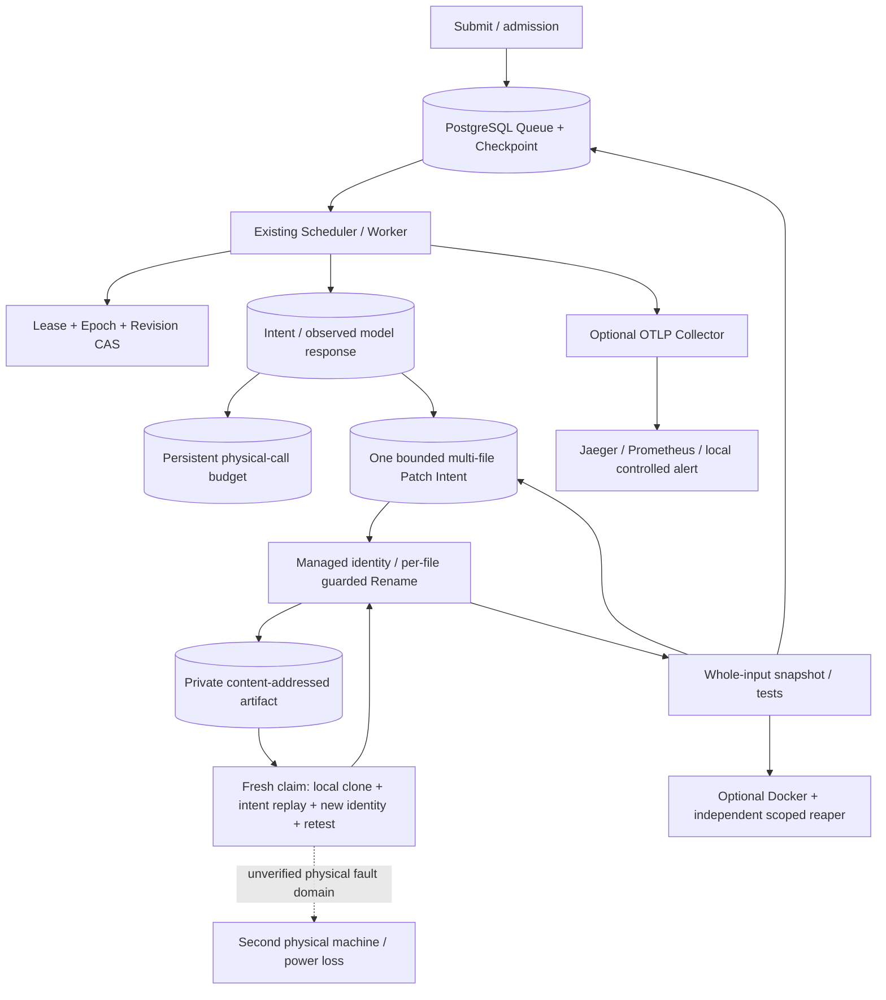
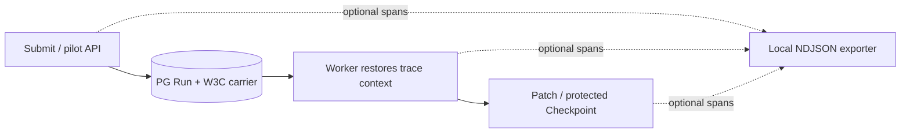

# Architecture

<!-- runtime-followup:start -->
## 2026-10-22 follow-up

The shared metadata-only internal/goinput planner connects repair17/executor; Worker sandbox v4 binds input mode. Four real sealed-input Docker scenarios passed. Artifact inventory is read-only, not a deletion protocol. [续批证据](review-20261020/RESULTS.md)
<!-- runtime-followup:end -->

## Local upgrade · 2026-10-22 (unpublished)

This section describes the current working tree; older dated “pending/BLOCKED” statements are historical. No commit, push or remote-CI result is implied.

Implemented bounded multi-file patches (up to 8 allowlisted existing Go files per repair round), persisted logical model responses with conservative unknown-outcome handling, real Docker confinement and an independent scoped orphan reaper, OTLP/metrics/local alert acceptance, paced/real-Go-test benchmark workloads, and content-addressed portable Worktree recovery. Two isolated host containers plus a separate authenticated artifact service passed actual A-container SIGKILL, natural lease expiration and a real Epoch2 ClaimBatch takeover. This remains one physical computer, with no physical-host/power-loss claim.

The frozen 12-task synthetic live evaluation made **11 actual requests**, **3382 input / 4201 output tokens**: 9 fresh repairs and one response-recovery control passed holdout assertions; an immutable failure control failed as expected; an already-passing baseline made zero requests. Mode: High, requested/returned alias `deepseek-flash`. The peak cache-miss estimate is **$0.0060558**, not an invoice, against this run's separately authorized $2 cap. These simple manually constructed tasks do not measure general repository repair accuracy.

Explicit sealed input policies capture offline vendor inputs or root-contained workspace modules, with shared fixed-command planning for trusted-local and sandbox execution. Terminal Worktrees can be inspected/dry-run and retired with identity/state checks and a persisted deletion intent. A separate fresh local PostgreSQL cluster restored synthetic data and read-only role permissions.

Portable recovery requires a previously published artifact and durable patch history. Disk loss before the first publication and unobserved model responses are not automatically recovered.

Remaining unverified: a second physical host, network partition/power loss, arbitrary hostile repositories, representative real-world defects and human review, production soak/capacity, and the cause of two historical negative DB wall-clock durations. Monotonic benchmark timing does not remove the Lease clock assumption.

---

[English](architecture.md) | [简体中文](zh-CN/architecture.md) | [Home](../README.md)

## Responsibilities and dependencies
runtimecore runs task.Task through executor.Registry with concurrent Workers
and result collection. persistence/httpapi provide a persistent task API.
This in-memory task runtime is distinct from durable Agent Run scheduling.

durable owns Queue, LeaseManager, FencedStore and Scheduler. Diagnosis providers
use durable.Runner plus repodiag. coding:* providers use CodingHandler and
repair20.Agent. Both reuse the same claims, heartbeat and Scheduler lifecycle;
the diagnosis model factory is not invoked for coding proposals.

Production dependencies: durable → repair20/repair19;
repair20 → repair19/repair18/repair17; repair19 → repair17.
internal/integration20 is test-only and references those packages one-way.
No production module imports it or needs a private-test export bridge.

## Schemas
Apply migrations in order: 001 creates day12.agent_runs/checkpoints; 002 adds
Lease owner/Epoch/expiry; 003 adds queue/priority/availability/retry_count;
004 adds budgets/failures/times/run_events; 005 creates day19 repair_runs and
patch_ops; 006 adds Worktree Identity and causal round_number; 007 adds scoped pilot identities and execution profiles; 008 adds shared model admission/accounting; 009 adds outcome_verdict and diagnostic_report.

HTTP persistence uses its own tasks schema through EnsureTaskSchema; tests
apply schema.sql in random runtime_test_* schemas.
Production events are unique by (run_id, revision, event_type); a legacy Day15
fixture has another shape, detected by Store. Equal-revision same-type
observations may merge; this is not one guaranteed event per attempt.

## Execution status and diagnostic evidence

Terminal checkpoint writes freeze finished_at in the protected transaction. Duration summaries separate completed, still-running and unknown historical timestamps. Diagnostic succeeded means execution completed; outcome_verdict separately records evidence_consistent, insufficient_evidence or inconsistent_evidence. Structured reports check current tool-call references, persisted-output hashes and actual test execution metadata. This does not prove narrative root causes. Coding uses tests_passed/tests_failed. Both provider adapters share internal/providererr; details and tests are in the [review implementation](review-20261020/IMPLEMENTATION.md).

## Worktree lifecycle
repair17.Prepare creates a detached Git Worktree with Run/baseline metadata
and a random identity token. repair19.Register binds its absolute path, source
commit and identity to the logical Run. Recovery opens and validates that
same binding. Missing, symlinked, replaced or rebased workspaces fail closed.
Retain an unfinished Run's workspace for recovery; integration fixtures own
their temporary sources and cleanup.

## Persistence boundary
Short operations lock agent_runs, then repair_runs/patch_ops. Claim and Renew
contend on the same Run row. Guarded Rename is followed by authority/hash
validation before result commit. Model calls and Go tests run outside those
row-lock transactions. This is a trusted single-writer/shared-local-filesystem
model, not a sandbox or filesystem/database distributed transaction.

## Evaluation boundary

eval21.Score aggregates validated Observation records; cmd/day21-eval parses
manifests/JSONL and writes reports. Neither adds another Scheduler or Repair Loop.
TestDay21Capture drives the existing Scheduler with deterministic proposals and
collects independent baseline, Worktree-test, source-cleanliness and checkpoint evidence.
See [evaluation](evaluation.md).

## Local verification/completion boundary · 2026-10-21

The existing Patch Store now binds cached verdicts to a bounded candidate-tree snapshot, managed identity, command, toolchain and environment digest. Only standalone stdlib-only Go modules are accepted by this contract. On the last execution claim, a persisted successful verdict can be finalized without another claim/model call if the complete verification identity still matches. A completion marker is not proof; validation, temporary authority and the fenced terminal checkpoint are protected by one Run-row transaction. See the companion local implementation/results. These local changes are not yet published.

## Local extension / 本地观测扩展 · 2026-10-21（未发布）

This is implemented local SDK tracing, not an OTLP monitoring platform. It does not grant execution authority or reconstruct Worktrees across hosts. / 已实现可选SDK追踪；启用前应用001–012，默认关闭。真实跨进程传播有回归，不能替代Lease/Epoch或代表跨主机恢复；SIGKILL可丢失未导出span。[最新结果](review-20261020/RESULTS.md)
