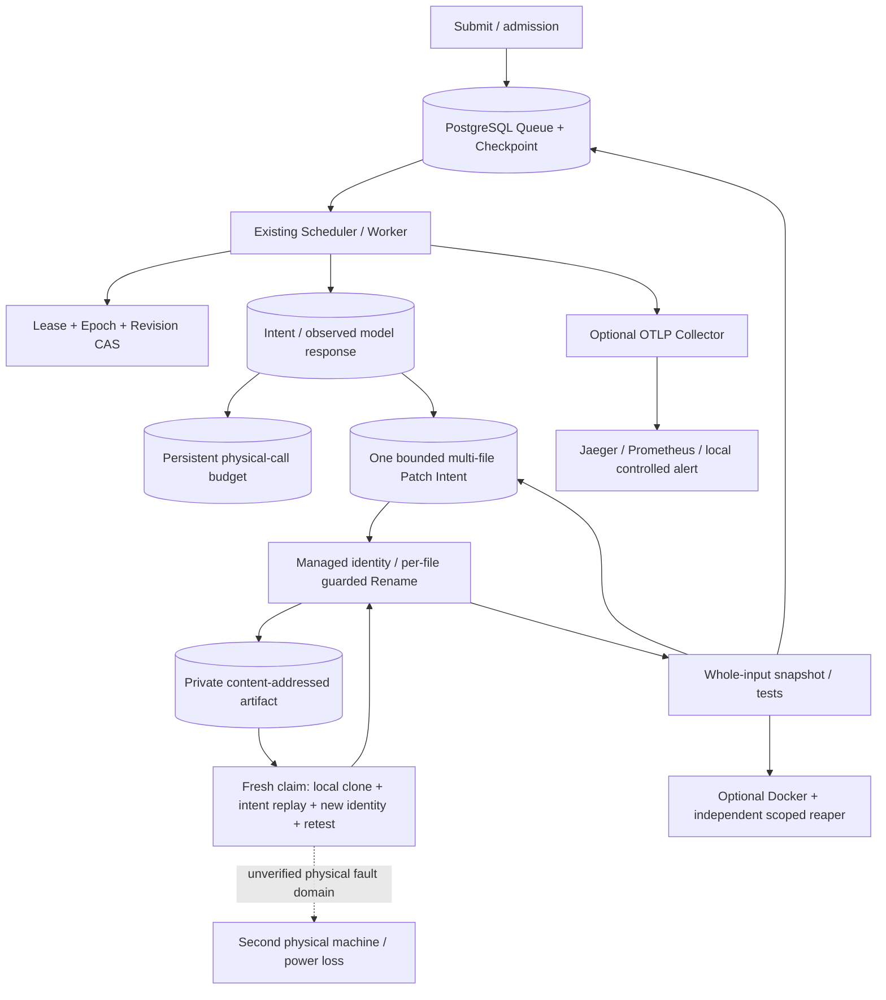
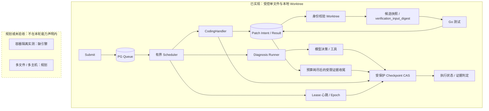
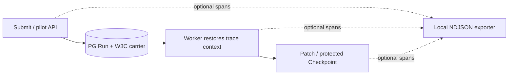

# 系统架构

<!-- runtime-followup:start -->
## 2026-10-22 续批更新

共享 `internal/goinput` 元数据规划器连接 `repair17` 与 `executor`，Worker沙箱v4包含输入策略；4个真实vendor/workspace场景通过。制品盘点只读，未实现删除协议。 [续批证据](../review-20261020/RESULTS.md)
<!-- runtime-followup:end -->

## 2026-10-22 本地升级：实现与验收范围

本节是当前本地工作树；此前各日期的表格、BLOCKED 和“尚未实现”是历史快照。未提交或推送，本页不继承旧远端 CI。

| 方向 | 本轮交付 | 证据与边界 |
|---|---|---|
| 多文件补丁 | 同一逻辑轮次最多 8 个白名单 Go 文件，逐文件 before/after 摘要、全清单预检、统一验证 | 真实 Claim + 5 个 SIGKILL 窗口，含第一个 Rename 后的混合状态；多个 Rename 与 SQL 仍非原子操作 |
| 真实沙箱 | 固定镜像摘要、非 root、只读根、无网络、资源上限、超时；独立按身份清理孤儿 | 已运行真实 Docker；不是恶意内核逃逸证明，docker 组具有管理员级权限 |
| 模型恢复 | 请求意图、已观察响应与 Usage 持久化，恢复先复用响应；未知结果拒绝自动重发 | 3 个实际 SIGKILL 窗口；显式再授权最多 3 个逻辑尝试，物理费用预算另行约束，不保证 provider Exactly-once |
| 真实评测 | 冻结 12 项人工合成任务，High、deepseek-flash、单轮 | 11 次真实调用，3382 输入 / 4201 输出 Token；9 个新修复、1 个恢复对照通过独立断言，1 个不可修复对照按预期失败、1 个基线通过且零调用 |
| OTel | OTLP HTTP → Collector → Jaeger / Prometheus，耗时与错误指标、有界导出重试 | 实际读取 1 条新 Trace / 3 个 Span、指标和 firing 告警；受控错误，无外部联系人，SIGKILL 仍可能丢失缓冲数据 |
| 基准 | 真实 PG 固定等待、持续到达，以及真实 Worktree + Go test 负载 | 使用单调计时，保留数据库墙钟原值与异常计数；具体轮次见机器结果，不代表 LLM 吞吐或生产容量 |
| 可迁移 Worktree | 基线 commit + 有界全文件制品 + 持久化补丁链；新 Claim 下重建身份并重验 | 两个独立容器目录和第三个制品服务已验证；A SIGKILL、自然到期、B 真实 Epoch2 接管；只有一台物理电脑 |
| 输入与生命周期 | 显式 sealed-vendor / sealed-workspace 离线输入策略；终态 Worktree dry-run/受保护退役；数据库与角色恢复实验 | sealed 输入已完成 4 个真实沙箱场景；Workspace 限根内模块，不支持任意依赖图；数据库恢复只使用新建合成库 |

真实调用收到的型号字段为 `deepseek-flash`，这是服务端别名，不是不可变模型权重快照。2026-10-22 官方文档将它路由至 DeepSeek-V4.1-Flash-1017。峰时 cache-miss 上界估价 **$0.0060558**，不是供应商账单；本轮授权上限 $2，历史预算没有挪用。原始响应不公开推理内容或 Key。

可迁移恢复只覆盖已有已提交制品和持久化补丁链；首次制品提交前丢盘、未观察模型输出及任意外部副作用不能自动恢复。

仍未验证：第二台物理主机、网络分区/断电、任意不可信大型仓库、真实开源缺陷总体修复率、独立人工判定、长时生产压力/SLA，以及历史两条数据库负时长的根因。单调计时没有消除 Lease 对数据库墙钟的依赖。没有自动提交、推送或对外发布。

---

[English](../architecture.md) | [简体中文](architecture.md) | [中文首页](../../README.zh-CN.md)

本文介绍本仓库实现中的组件与边界。

## 实现链路与规划边界

下方虚线框没有已验收的数据流连接，不表示这些组件已投入运行。源码定位、验证和限制见[能力索引](../review-20261020/IMPLEMENTATION.md)。

## 组件职责与依赖关系

runtimecore 通过 executor.Registry 并发执行 task.Task，并收集执行结果。
persistence/httpapi 提供持久化任务 API。
这套内存任务运行时与持久化 Agent Run 调度是不同的层次。

durable 管理 Queue、LeaseManager、FencedStore 和 Scheduler。
诊断 Provider 使用 durable.Runner 与 repodiag；coding:* Provider 使用
CodingHandler 与 repair20.Agent。两条路径复用相同的领取、心跳和调度生命周期；
代码修复提案不会调用诊断模型工厂。

生产模块依赖为：durable → repair20/repair19；
repair20 → repair19/repair18/repair17；repair19 → repair17。
internal/integration20 仅用于测试，单向引用这些模块。
生产模块不导入它，也不需要为其额外暴露私有测试辅助函数。

## 数据库结构

实现按顺序应用数据库迁移：

| 迁移 | 主要变化 |
| --- | --- |
| 001 | 创建 day12.agent_runs/checkpoints |
| 002 | 增加租约持有者、Epoch 和到期时间 |
| 003 | 增加队列、优先级、可用时间与 retry_count |
| 004 | 增加预算、失败信息、时间字段与 run_events |
| 005 | 创建 day19.repair_runs 与 patch_ops |
| 006 | 增加 Worktree Identity 和表示因果顺序的 round_number |
| 007 | 增加试点身份、登记仓库、幂等与 execution profile |
| 008 | 增加跨 Worker 模型准入与持久费用预留 |
| 009 | 增加 outcome_verdict 与 diagnostic_report，旧记录不追认为已验证 |

HTTP 持久化通过 EnsureTaskSchema 管理独立的 tasks 结构；
测试在随机的 runtime_test_* schema 中应用 schema.sql。

生产事件以 (run_id, revision, event_type) 保证唯一。
旧 Day15 测试夹具使用另一种结构，由 Store 识别。
相同版本、相同类型的观测可能合并，因此不能将其理解为“每次尝试必有一条独立事件”。

## 执行状态与诊断证据

受保护的终态 Checkpoint 事务同时冻结 finished_at；统计分开完成、运行中与历史时间缺失。诊断 succeeded 仅表示流程完成，outcome_verdict 独立标识证据一致、缺证据或证据冲突；检查实际测试执行元数据、当前工具引用与持久化文本摘要，不证明自由文本根因。编码路径另记录 tests_passed/tests_failed。两种模型适配器共用 internal/providererr，详见[本轮实现](../review-20261020/IMPLEMENTATION.md)。

## Worktree 生命周期

repair17.Prepare 创建分离 HEAD 的 Git Worktree，并写入 Run、基线信息与随机身份令牌。
repair19.Register 将其绝对路径、源码提交和身份绑定到逻辑 Run。
恢复时重新打开并验证同一份绑定。

工作区丢失、路径成为符号链接、身份被替换或基线被 rebase 时，校验会拒绝继续执行。
尚未完成的 Run 需要保留工作区以便恢复；
集成测试夹具负责自己创建的临时源码与清理工作。

## 持久化边界

短事务先锁定 agent_runs，再锁定 repair_runs/patch_ops。
Claim 与 Renew 竞争同一条 Run 记录。
受保护的 Rename 之后，还要验证执行权限与文件哈希，才能提交结果。

模型请求与 Go 测试在行锁事务之外运行。
该方案依赖可信写入者与共享的本地文件系统；
不提供沙箱，也不构成文件系统与数据库之间的分布式事务。

## 评测边界

eval21.Score 汇总经过校验的 Observation；
cmd/day21-eval 读取场景清单与 JSONL，输出报告。
它们不引入另一套 Scheduler 或 Repair Loop。
TestDay21Capture 使用现有 Scheduler 和确定性提案，
独立核查基线、Worktree 测试、原始仓库干净状态与检查点。
详见[评测方法](evaluation.md)。

## Local extension / 本地观测扩展 · 2026-10-21（未发布）

This is implemented local SDK tracing, not an OTLP monitoring platform. It does not grant execution authority or reconstruct Worktrees across hosts. / 已实现可选SDK追踪；启用前应用001–012，默认关闭。真实跨进程传播有回归，不能替代Lease/Epoch或代表跨主机恢复；SIGKILL可丢失未导出span。[最新结果](../review-20261020/RESULTS.md)
